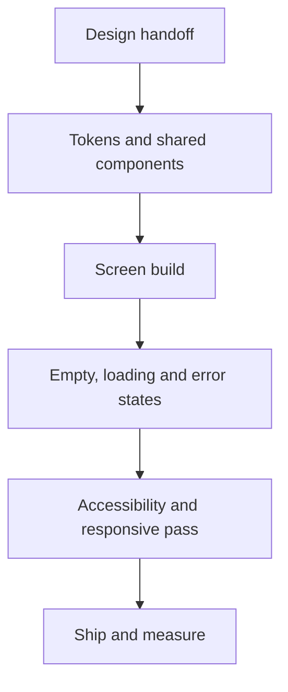

<!-- ============================================================
     Profile README — built like a design handoff sheet.
     One column everywhere, so phones and desktops read the same.
     ============================================================ -->

<picture>
  <source media="(prefers-color-scheme: dark)" srcset="https://capsule-render.vercel.app/api?type=waving&color=0:6C63FF,100:00C2A8&height=170&section=header&text=Eswar%20Varma%20Panumetcha&fontSize=40&fontColor=ffffff&desc=Frontend%20%26%20Mobile%20Engineer&descSize=18&descAlignY=80&animation=twinkling">
  
</picture>

 

> [!NOTE]
> **Open handoff.** I take product screens that grew screen by screen and turn them into one consistent, reusable UI layer — shared components, honest states, motion that explains itself. Two tracks are live right now: **Logray** and **JOYIZM**. I'm also building **PROEDIT**, a local-first mobile video editor, and **home widgets**.

---

## 01 · 🎨 Logray — UI enhancement track

|  |  |
|:--|:--|
| **Status** | ● In build |
| **Scope** | Existing product screens → one reusable UI layer |
| **Craft** | Components · tokens · motion · accessibility · responsive |
| **Stack** | React · TypeScript · Ionic React · Capacitor |

Logray's interface grew feature by feature, so the job is consolidation: one component per job, one spacing and type scale, screens that behave the same at 360px and at 1440px. The product screens stay private — the approach doesn't.

| Before | After |
|:--|:--|
| Styled per screen | One component per job |
| Spacing eyeballed | Token scale |
| Blank jump on load | Skeletons + empty/error |
| Random tap targets | ≥44px, visible focus |
| “Works on my screen” | Phone → desktop checked |

- 🧩 **Component inventory first** — repeated blocks get pulled into one component with props, instead of a copy per screen.
- 📐 **Screen-by-screen refinement** — hierarchy, alignment and density brought in line with the rest of the product.
- ⚡ **Interaction polish** — transitions and loading feedback that explain what changed, not decoration.
- ♿ **Accessibility as a pass, not a hope** — contrast, focus order, keyboard paths and screen-reader labels verified.
- 📱 **Responsive by construction** — the same screen and the same logic from phone to desktop.

<!-- ============================================================
     Logray screenshot gallery — BLOCKED ON IMAGES.
     Add files to assets/logray/ (see the README in that folder), then
     delete the three comment lines below to publish the gallery.
     Replace the captions with what each screen actually shows.
     ============================================================

  
   
  <b>Before</b> — screens styled one at a time

  
   
  <b>After</b> — shared components, token-based spacing, real loading states

  
   
  <b>System</b> — the component layer the screens are built from

-->

---

## 02 · PROEDIT — local-first mobile video editor

|  |  |
|:--|:--|
| **Status** | ● In build |
| **Project** | PROEDIT — Edit. Grade. Export. |
| **Platforms** | iOS 15+ and Android 7.0+ (minSdk 24) |
| **Stack** | Flutter · Cubits only · FFmpeg · SQLite |

PROEDIT is a complete, local-first mobile video editor. It uses a proxy-based editing workflow with a single-pass FFmpeg export graph, so scrubbing stays smooth on a phone while the final render always uses the original camera files.

| Area | What you get |
|:--|:--|
| Library | Multi-select import from Photos, the two bundled demo clips, or Pexels stock |
| Timeline | Multi-track video strip with drag-free trim handles, split, reorder, delete, undo/redo |
| Editing | Speed 0.25×–4×, 36 color looks + brightness/contrast/saturation, fit/fill framing, canvas colour, rotation/flip, text overlays with 9 presets + free drag placement, clip volume/mute |
| Finishing | Project fade-in and fade-out from black, covering text and PIP |
| Audio | Per-clip volume, background music import, fade in and automatic 1.5s outro fade |
| Transitions | Cut, dissolve, fade, slide, wipe, zoom, clamped to 45% of adjacent clips |
| PIP | Up to six picture-in-picture layers per project, each with 9 anchors, its own start time, size, opacity, volume and optional green/blue-screen backdrop removal |
| Merge | Two-clip side-by-side, stacked or overlay merge; overlay mode can key out a plain backdrop |
| Editing defaults | Persistent studio setup: export frame, resolution, fps and quality, plus default transition and length, clip framing, clip volume and project fades |
| Templates | 12 curated recipes plus an optional pack library; picking a template applies its filters, frame size, pacing, fades, titles and optional generated voice intro |
| Collage | 2, 4, 6, 8, 10 or 12 clips as side-by-side, stacked, feature or automatic grid; saved as a project and exported as one video |
| Stock | Optional Pexels video search; clips download, then follow the normal probe/proxy/import path |
| Export | 720p / 1080p / 4K, 16:9 / 9:16 / 1:1 / auto, 24/30/60 fps, draft/balanced/high, hardware H.264 when available |
| Export queue | Up to 10 jobs; Android keeps the render alive in a foreground service, iOS keeps the queue in-app |
| Sharing | Save to Photos, share sheet, or keep the file in the app export folder |
| Ads | Master toggle off by default, banners only on Gallery/Settings, one interstitial only after a successful export |

[🌐 GitHub repo →](https://github.com/EswarVarma91/video_editor)

---

## 03 · ✨ JOYIZM — UI enhancement track

|  |  |
|:--|:--|
| **Status** | ● In build |
| **Product** | Urban lifestyle membership — sport, wellness, meals, travel |
| **Scope** | iOS · Android · web, one design language |
| **Stack** | Next.js web · native apps · design system |

- 📱 **One experience across iOS, Android and web** — discover → book → pay → manage membership.
- 🧩 **Eight verticals in a single app**: events, meals, wellness, shop, deals, travel, activities, games.
- 🍽️ **Booking and redemption flows** — including the daily featured kitchen.
- 💳 **JOY Cash wallet** — balance, top-up and spend screens.
- 🧭 **Guest-first browsing** — see what's on nearby before signing up.
- 🎟️ **Member rates, trips and partner gym access** surfaced without menu digging.

**[🌐 joyizm.com](https://joyizm.com)** · **[App Store](https://apps.apple.com/us/app/joyizm/id1591948916)** · **[Google Play](https://play.google.com/store/apps/details?id=com.rezy360.joyizm)**

---

## 04 · Selected repositories

### 🏢 e-biz-3.0 — enterprise app platform

HRMS, CRM, travel and hotel modules with live location tracking in one mobile app, shipped in versioned releases with a running changelog.

`Dart` · `Flutter` · [View repo →](https://github.com/EswarVarma91/e-biz-3.0)

### 🫁 ventilator — medical device app

Flutter app built with Zyna MedTech for a Covid-19 ventilator product.

`Dart` · `Flutter` · [View repo →](https://github.com/EswarVarma91/ventilator)

### 🧪 flutter_training — practice project

Scratch space for Flutter experiments and UI exercises.

[View repo →](https://github.com/EswarVarma91/flutter_training)

**[All repositories →](https://github.com/EswarVarma91?tab=repositories)**

---

## 05 · How a screen gets shipped

> [!TIP]
> **My rule of thumb:** if a second screen needs the same block, it becomes a component before it gets built twice. Design debt compounds faster than technical debt.

---

## 06 · Contact

|  |  |
|:--|:--|
| 📧 **Email** | [varmapanumetcha02@gmail.com](mailto:varmapanumetcha02@gmail.com) |
| 📱 **Phone / WhatsApp** | [+91 9014832822](tel:+919014832822) · [Message on WhatsApp](https://wa.me/919014832822) |
| 💻 **GitHub** | [@EswarVarma91](https://github.com/EswarVarma91) |

<!-- Add your LinkedIn and it goes straight into the badge row above:

and as a row in the contact table:

| 💼 **LinkedIn** | [your-name](https://www.linkedin.com/in/YOUR-HANDLE) |

-->

**Open to conversations about frontend architecture, design systems and mobile UI.**

---

<b>🛠️ Full stack</b> — tap to expand

 

**Core**

**Mobile & cross-platform**

**Styling & tooling**

<b>📊 GitHub in numbers</b> — tap to expand

 

<picture>
  <source media="(prefers-color-scheme: dark)" srcset="https://capsule-render.vercel.app/api?type=waving&color=00C2A8&height=90&section=footer">
  
</picture>
