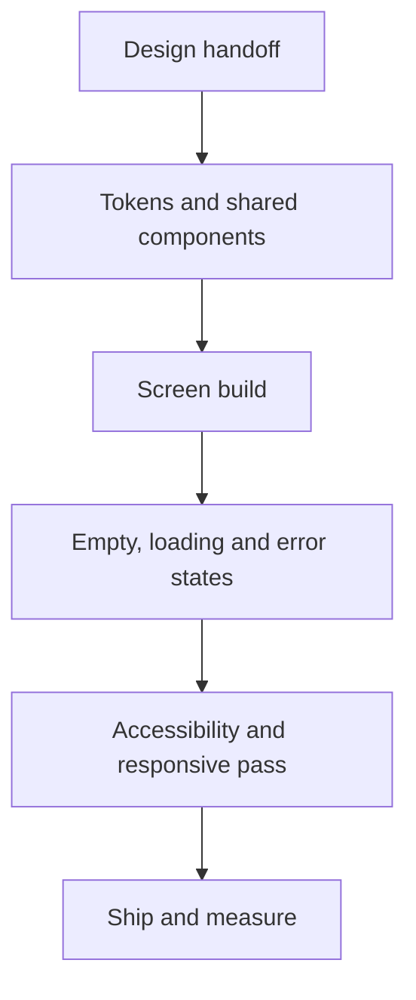

<!-- ============================================================
     Profile README — built like a design handoff sheet.
     One column everywhere, so phones and desktops read the same.
     ============================================================ -->

<picture>
  <source media="(prefers-color-scheme: dark)" srcset="https://capsule-render.vercel.app/api?type=waving&color=0:6C63FF,100:00C2A8&height=170&section=header&text=Eswar%20Varma%20Panumetcha&fontSize=40&fontColor=ffffff&desc=Frontend%20%26%20Mobile%20Engineer&descSize=18&descAlignY=80&animation=twinkling">
  
</picture>

 

> [!NOTE]
> **Open handoff.** I take product screens that grew screen by screen and turn them into one consistent, reusable UI layer — shared components, honest states, motion that explains itself. Two tracks are live right now: **Logray** and **JOYIZM**.

---

## 01 · 🎨 Logray — UI enhancement track

|  |  |
|:--|:--|
| **Status** | ● In build |
| **Scope** | Existing product screens → one reusable UI layer |
| **Craft** | Components · tokens · motion · accessibility · responsive |
| **Stack** | React · TypeScript · Ionic React · Capacitor |

Logray's interface grew feature by feature, so the job is consolidation: one component per job, one spacing and type scale, screens that behave the same at 360px and at 1440px. The product screens stay private — the approach doesn't.

| Before | After |
|:--|:--|
| Styled per screen | One component per job |
| Spacing eyeballed | Token scale |
| Blank jump on load | Skeletons + empty/error |
| Random tap targets | ≥44px, visible focus |
| “Works on my screen” | Phone → desktop checked |

- 🧩 **Component inventory first** — repeated blocks get pulled into one component with props, instead of a copy per screen.
- 📐 **Screen-by-screen refinement** — hierarchy, alignment and density brought in line with the rest of the product.
- ⚡ **Interaction polish** — transitions and loading feedback that explain what changed, not decoration.
- ♿ **Accessibility as a pass, not a hope** — contrast, focus order, keyboard paths and screen-reader labels verified.
- 📱 **Responsive by construction** — the same screen and the same logic from phone to desktop.

---

## 02 · ✨ JOYIZM — UI enhancement track

|  |  |
|:--|:--|
| **Status** | ● In build |
| **Product** | Urban lifestyle membership — sport, wellness, meals, travel |
| **Scope** | iOS · Android · web, one design language |
| **Stack** | Next.js web · native apps · design system |

- 📱 **One experience across iOS, Android and web** — discover → book → pay → manage membership.
- 🧩 **Eight verticals in a single app**: events, meals, wellness, shop, deals, travel, activities, games.
- 🍽️ **Booking and redemption flows** — including the daily featured kitchen.
- 💳 **JOY Cash wallet** — balance, top-up and spend screens.
- 🧭 **Guest-first browsing** — see what's on nearby before signing up.
- 🎟️ **Member rates, trips and partner gym access** surfaced without menu digging.

**[🌐 joyizm.com](https://joyizm.com)** · **[App Store](https://apps.apple.com/us/app/joyizm/id1591948916)** · **[Google Play](https://play.google.com/store/apps/details?id=com.rezy360.joyizm)**

---

## 03 · How a screen gets shipped

> [!TIP]
> **My rule of thumb:** if a second screen needs the same block, it becomes a component before it gets built twice. Design debt compounds faster than technical debt.

---

## 04 · Contact

|  |  |
|:--|:--|
| 📧 **Email** | [rocktheway3@gmail.com](mailto:rocktheway3@gmail.com) |
| 💬 **WhatsApp** | [+91 9014832822](https://wa.me/919014832822) |
| 📞 **Call** | [+91 9014832822](tel:+919014832822) |
| 💻 **GitHub** | [@EswarVarma91](https://github.com/EswarVarma91) |

<!-- Add your LinkedIn and it goes straight into the badge row above:

and as a row in the contact table:

| 💼 **LinkedIn** | [your-name](https://www.linkedin.com/in/YOUR-HANDLE) |

-->

**Open to conversations about frontend architecture, design systems and mobile UI.**

---

<b>🛠️ Full stack</b> — tap to expand

 

**Core**

**Mobile & cross-platform**

**Styling & tooling**

<b>📊 GitHub in numbers</b> — tap to expand

 

<picture>
  <source media="(prefers-color-scheme: dark)" srcset="https://capsule-render.vercel.app/api?type=waving&color=00C2A8&height=90&section=footer">
  
</picture>
